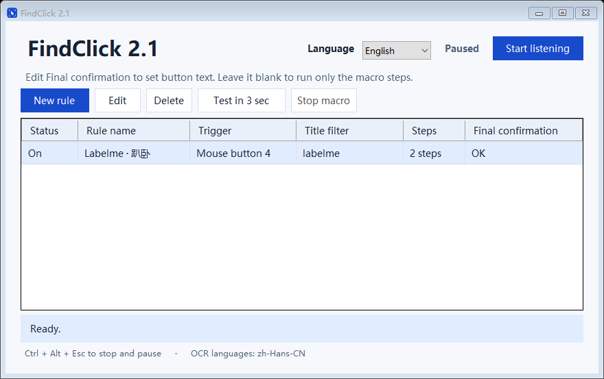

# FindClick for Windows

[简体中文](README.md) · [Disclaimer](DISCLAIMER.md)

FindClick is a Windows desktop macro tool. Bind a keyboard shortcut or mouse button to find and click Chinese or English text, or run a sequence of keyboard and mouse actions. The included Labelme example selects a label and confirms it.



## Download and run

Download `FindClick-2.1.0.exe` from this repository's **Releases** and run it. FindClick uses Windows .NET Framework and Windows OCR. The OCR languages available on your computer depend on the installed recognition language packs and are listed at the bottom of the main window.

Use the **Language** menu at the top right of the main window to switch between **简体中文** (Simplified Chinese) and **English**. The default is Simplified Chinese. Changes take effect immediately and are remembered. The setting does not change OCR languages, rule names, search text, or final confirmation text.

1. Open the Labelme label dialog. Select the example rule in FindClick, click **Test in 3 sec**, and switch back to the dialog. The test checks visible text and buttons without sending input.
2. In FindClick, click **Start listening**. Switch back to Labelme, then press and release the first side button on your mouse. The example selects `趴窝` or `趴卧`, then clicks `OK`.
3. Press **Ctrl + Alt + Esc** to stop the macro and pause listening.

## Create your own macro

- **Trigger.** Click the binding field, then press and release the input you want to use. Keyboard shortcuts, mouse buttons, and the wheel are supported. Select **×** to clear and rebind.
- **Window filter.** Use **Window title contains** to restrict the rule to specific window titles. Leave it blank to match any foreground window.
- **Macro steps.** Combine text searches, keyboard and mouse actions, and waits in sequence. You can use timed holds, separate press and release steps, and window-relative coordinates. Each rule supports up to 128 steps and 20 repetitions.
- **Final confirmation.** Edit this cell in the main window. Leave it blank to run only the steps. Enter the visible button text, such as `OK` or `确定`, to click it once after all repetitions finish. Any **Find and click button** step with the same text is deferred to that final click.

## Known limitations

- FindClick can operate only on the foreground window. Switching to another window during execution stops the macro.
- Screenshot recognition in Labelme list mode supports dialogs up to **1600 pixels wide** and **1300 pixels high**.
- When **Restore pointer** is enabled, wait for the macro to finish before moving the mouse. FindClick does not restore the pointer if you have moved it away from the last automated position.

## Privacy

Screenshots and text recognition are processed locally. FindClick does not connect to the internet or upload screenshots or recognized text. Rules are stored in `%LOCALAPPDATA%\FindClick2.1\rules.xml`. The language preference is stored separately in `ui-language.txt` in the same folder.

## Build from source

Open PowerShell in the folder containing `build.ps1` and run:

```powershell
powershell.exe -NoProfile -ExecutionPolicy Bypass -File .\build.ps1
```

The script uses the 64-bit Windows .NET Framework C# compiler and creates `FindClick2.1.exe`. No NuGet dependencies are required. Source files are under `src/`: `App.cs` and `Editors.cs` implement the UI, `UiText.cs` handles the UI language preference, `InputMonitor.cs` handles bindings, `Runner.cs` runs macros, and `Engine.cs` and `Ocr.cs` find controls and recognize screen text.
