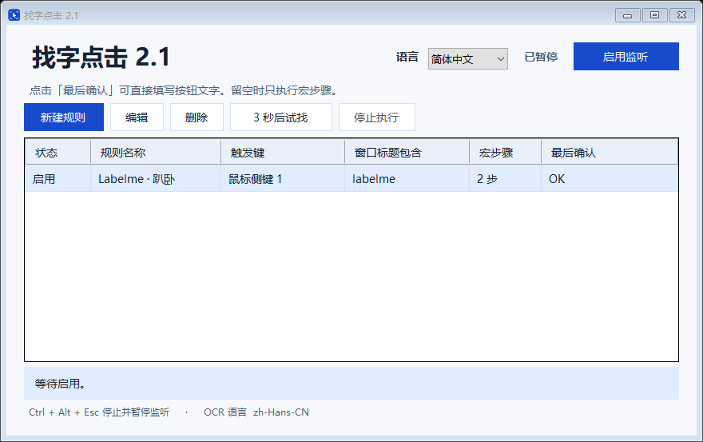

# 找字点击 · FindClick

[English](README.en.md) · [免责声明 / Disclaimer](DISCLAIMER.md)

找字点击是一个 Windows 桌面宏工具。绑定键盘或鼠标按键后，它会在目标窗口查找中文或英文、点击按钮，或按顺序执行键鼠动作。内置 Labelme 示例可用于快速选择标签并确认。



## 下载与使用

从本仓库的 **Releases** 下载 `FindClick-2.1.0.exe`，双击运行。程序使用 Windows 的 .NET Framework 和系统 OCR 功能。OCR 语言取决于电脑上安装的识别语言包，可在主界面底部查看。

首页右上角的 **语言** 菜单可在 **简体中文** 和 **English** 之间切换，默认简体中文，切换立即生效并在下次启动时保留。界面语言不影响 OCR 语言，也不会更改规则名称、查找文字或最后确认文字。

1. 打开 Labelme 的标签弹窗。在「找字点击」选中示例规则，点击 **3 秒后试找**，切回弹窗。试找会检查可见文字和按钮，全程保持弹窗原样。
2. 回到「找字点击」，点击 **启用监听**。切回弹窗并按鼠标侧键 1，示例宏会选择「趴窝」或「趴卧」，然后点击 `OK`。
3. 按 **Ctrl + Alt + Esc** 停止执行并暂停监听。

## 创建自己的宏

- **触发键**。点击绑定框后按下并松开要使用的键。支持键盘组合键、鼠标左右键、中键、侧键和滚轮。点击 **×** 可以重新绑定。
- **执行范围**。填写「窗口标题包含」可限定在指定窗口触发。留空可匹配任意前台窗口。
- **宏步骤**。可以按顺序组合找字、键鼠动作和等待，支持定时按住、分步按下与松开，以及窗口内坐标。每条规则最多 128 步、20 轮。
- **最后确认**。单击首页表格中的「最后确认」即可编辑。留空时按列表执行宏步骤。填写 `OK`、`确定` 等按钮文字后，宏完成全部轮次才确认一次。宏中同名的「找按钮并点击」步骤会合并到最后确认。

## 已知限制

- 只能操作当前前台窗口，不能在后台运行宏。执行过程中切换前台窗口会停止宏。
- Labelme 列表模式的截图识别仅支持宽度不超过 **1600 像素**、高度不超过 **1300 像素** 的对话框。
- 启用「执行后恢复指针」时，按下宏触发键后不要立即移动鼠标，等宏执行完再移动。若指针离开了宏最后一次移动的位置，程序不会强行复位。

## 隐私

截图与文字识别均在本机完成。程序不联网，不上传任何截图或识别文字。规则保存在 `%LOCALAPPDATA%\FindClick2.1\rules.xml`，界面语言单独保存在同目录的 `ui-language.txt`。

## 从源码构建

在包含 `build.ps1` 的目录打开 PowerShell，然后运行：

```powershell
powershell.exe -NoProfile -ExecutionPolicy Bypass -File .\build.ps1
```

构建会在当前目录生成 `FindClick2.1.exe`。脚本使用 64 位 Windows 的 .NET Framework C# 编译器。构建和运行均使用 Windows 系统组件，无需安装 NuGet 依赖。

主要源码在 `src/`。`App.cs` 和 `Editors.cs` 负责界面，`UiText.cs` 负责界面语言设置，`InputMonitor.cs` 处理键鼠录入和触发，`Runner.cs` 执行宏，`Engine.cs` 和 `Ocr.cs` 查找界面控件和屏幕文字。

